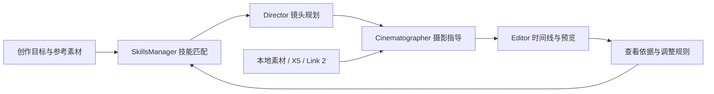

# ScenePilot

**让创作意图成为镜头，让摄影经验成为可复用的技能。**

ScenePilot 是面向影像创作者的 AI 摄影导演工作台，围绕拍摄前、拍摄中和拍摄后三个阶段，将自然语言交互、多智能体协作、摄影技能库与 Insta360 设备接入整合到同一条创作流程中。

从一句拍摄想法出发，用户可以规划镜头、结合实时画面获得摄影建议，再将素材组织为剪辑时间线和视频预览。项目源于影石 BoldMaker 比赛，是一个持续迭代的产品原型。

## 产品理念

拍摄的难点不只在于操作相机，还包括“拍什么、怎么拍、如何把素材讲成一个故事”。ScenePilot 将这些决策拆解为可理解、可调整的步骤，让用户始终保有创作方向的决定权。

摄影知识以 **Skills** 的形式组织：既可以匹配现有规则，也可以将自然语言经验转化为结构化技能。用户能够查看建议的依据、调整规则并重新运行，让 AI 成为创作过程中的助手。

## 核心功能

| 能力 | 产品体验 |
| --- | --- |
| 自然语言创作 | 描述拍摄目标，结合参考图片或视频组织创作流程 |
| 智能镜头规划 | Director 分析目标与参考素材，生成镜头安排和拍摄建议 |
| 实时摄影指导 | Cinematographer 接收视频帧，结合目标和摄影规则分析画面、提供建议 |
| 摄影技能库 | SkillsManager 匹配本地 YAML 技能，支持将专家经验转化为可复用规则 |
| 剪辑工作区 | Editor 组织素材、生成时间线和可播放预览，支持进一步调整 |
| 设备与素材联动 | 接入 Insta360 X5、Link 2 的设备控制与预览，将采集内容连接到创作工作区 |
| 决策可追溯 | 通过 `decision_trace` 查看使用的技能、规则、媒体证据和 Agent 决策摘要 |

## 一次创作如何完成

以“拍一段自然的人像短片，保留人物与环境的关系”为例：

1. **表达想法**：输入创作目标，导入参考图或已有素材。
2. **准备拍摄**：匹配摄影 Skills，由 Director 规划镜头顺序与画面重点。
3. **获得指导**：连接设备或提交本地素材，让 Cinematographer 结合画面给出建议。
4. **组织成片**：将素材交给 Editor，生成剪辑时间线与预览。
5. **调整创作**：查看决策依据，修改规则或输入，再次运行。



## 设备接入

当前设备融合入口位于 `agents_Module_good/front/`，通过独立设备桥接入相机：

- **Insta360 X5**：CameraSDK 获取预览流，MediaSDK 进行实时拼接，向前端提供 JPEG 帧。
- **Insta360 Link 2**：结合 UVCCameraSDK 与浏览器 UVC 视频流，实现设备控制和画面采集。
- **统一帧协议**：不同设备画面转换为 `VideoFrame`，提交给同一个 Cinematographer Session；后端按视频流分别维护短期帧记忆。

设备面板提供连接、预览、拍照、录像等操作入口；具体功能取决于设备类型、SDK 和本机环境。真实设备运行需要自行准备官方 SDK，仓库不包含这些 SDK。

详细接入方式见 [设备接入与项目融合说明](设备接入与融合README.md)。

## 系统结构

```text
浏览器创作工作台
    ├── Agent 服务 · 127.0.0.1:8765
    │   ├── SkillsManager / Director / Cinematographer / Editor
    │   ├── 摄影技能库与模型调用
    │   └── 素材、摄影会话与剪辑工作区
    └── 设备桥 · 127.0.0.1:8766
        ├── X5 · CameraSDK + MediaSDK
        └── Link 2 · UVCCameraSDK
```

主要技术包括 Python、FastAPI、Pydantic、OpenCV、FFmpeg、HTML/CSS/JavaScript 与 C++/CMake。模型层支持 Mock 演示与百炼 Qwen 系列模型调用；摄影规则使用 YAML 管理。

## 快速开始

### 1. 本地演示，无需相机或模型密钥

准备 Python 环境，在仓库根目录执行：

```powershell
python -m venv .venv
.\.venv\Scripts\python.exe -m pip install -r agents_Module_good/requirements.txt
cd agents_Module_good
..\.venv\Scripts\python.exe fast.py serve --mode mock
```

浏览器打开 **http://127.0.0.1:8765/app/create.html**。

Mock 模式用于体验工作台与接口流程，返回模拟的模型结果，不代表真实视觉理解效果。真实设备控制还需要启动 8766 端口的设备桥；视频预览生成等功能需要 FFmpeg。

### 2. 使用真实模型

在 `agents_Module_good/.env` 中配置自己的百炼凭据和模型参数，参考 [模型配置说明](agents_Module_good/docs/reference/MODEL_CONFIGURATION.md)。不要将密钥提交到 Git。

在 `agents_Module_good` 目录中执行：

```powershell
$env:SCENEPILOT_MODEL_CACHE = Join-Path $PWD "outputs/model_cache"
..\.venv\Scripts\python.exe fast.py serve --mode bailian
```

这里显式设置本机缓存位置，避免依赖开发环境中的默认盘符。真实模型调用需要网络连接、有效凭据及相应模型权限。

### 3. 连接真实设备

设备 Demo 面向 Windows x64，需要 Visual Studio 2022 Build Tools、CMake、FFmpeg 以及对应的 Insta360 官方 SDK。

按照 [设备接入说明](设备接入与融合README.md)，先调整 `构建X5服务.ps1` 和 `启动X5真实服务.ps1` 中的本机 SDK 路径，再构建设备服务。`启动前端.ps1` 提供 Agent 服务、设备桥与浏览器页面的联合启动入口，默认 Agent 模式为 `mock`；运行前需确保当前 Python 环境已经安装依赖。

## 仓库导航

| 目录 | 内容 |
| --- | --- |
| `agents_Module_good/` | 当前设备融合使用的 Agent 服务、正式前端、技能库与剪辑工作区 |
| `device_bridge/` | 本地设备桥服务 |
| `open-vide-vision-device-sdk/` | 设备抽象、X5 / Link 2 适配与 SDK 构建配置 |
| `edit_tool/` | 基于火山引擎 MediaKit 的素材拼接与转场工具 |
| `local_userdata_Module/` | 本地用户数据、素材和技能管理服务 |
| `algorithm_validation/` | 视频采样、事件分析与导演流程的算法验证 |
| `hardware_platform/` | 硬件平台与桥接方案 |
| `agents_Module/`、`agents_Module_fast/`、`front/` | 早期实现及其他迭代版本 |
| `doc/`、`backup/` | 设计文档与历史版本归档 |

## 更多文档

- [设备接入与项目融合](设备接入与融合README.md)
- [Agent 模块与产品流程](agents_Module_good/README.md)
- [API 使用与测试](agents_Module_good/API_USAGE_AND_TEST_GUIDE.md)
- [专家技能创作指南](agents_Module_good/docs/guides/专家技能创作指南.md)
- [设备 SDK](open-vide-vision-device-sdk/README.md)
- [视频拼接工具](edit_tool/README.md)

本仓库保留了多个迭代阶段的实现与文档。设备融合以根目录接入说明和 `agents_Module_good/` 当前代码为准；旧文档中关于设备尚未接入、本地路径和早期启动入口的描述可能不适用于当前版本。

---

**ScenePilot：把摄影知识变成可操作的建议，让创作从想法走向成片。**
